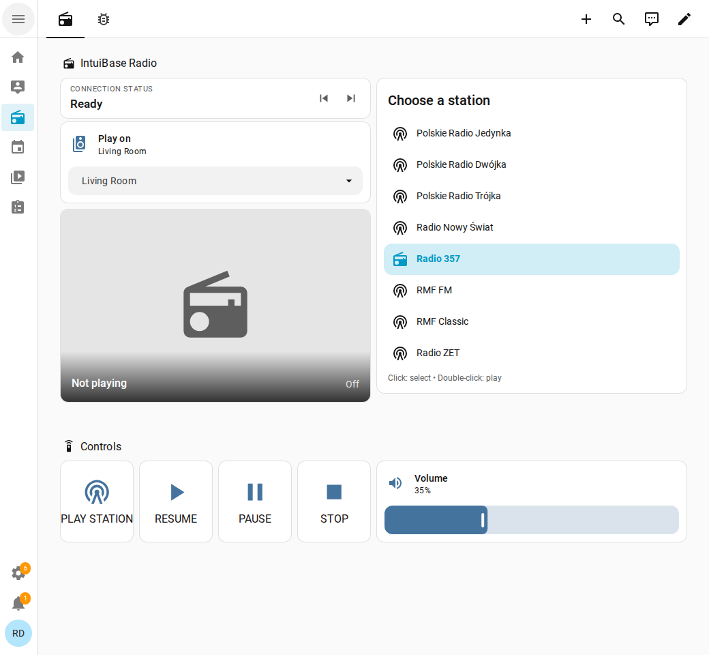
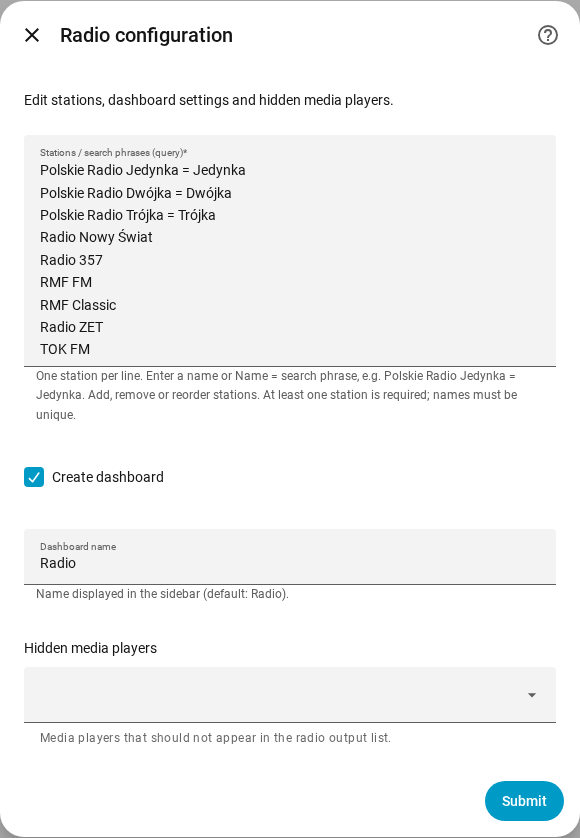

# IntuiBase Radio for Home Assistant

[](https://my.home-assistant.io/redirect/hacs_repository/?owner=intuibase&repository=ha-intuibase-radio&category=integration)

IntuiBase Radio is a standalone Home Assistant custom integration for playing
internet radio stations on available `media_player` entities.

The integration does not store stream URLs permanently. When a station is
selected, it searches the global [Radio Browser](https://www.radio-browser.info/)
directory, ranks the results, removes duplicate URLs, and tries the streams in
order. Searches and ranking are not restricted by country. API requests use the
Radio Browser network endpoint with a direct-server fallback and IPv4 transport.

## Screenshots

The English interface shown below runs in a local Home Assistant demo instance
with example media players.

### Radio dashboard

Choose a station and an output player, control playback and volume, and check
the connection status from the built-in dashboard.



### Station configuration

Edit the station list in the integration options. Enter one station per line,
or use `Display name = search phrase` to customize the Radio Browser query.
The same form controls the dashboard and hidden media players.



## Features

- editable list of Polish and international stations and search phrases;
- global, dynamic Radio Browser stream lookup;
- automatic discovery of `media_player` entities supporting `play_media`;
- remembered output selection and configurable player exclusions;
- native Home Assistant media-player entity;
- station and output selection;
- play, resume, pause, and stop controls;
- manual previous/next stream fallback controls;
- independent playback and automatic recovery on multiple outputs;
- volume control;
- optional integration-managed Lovelace dashboard;
- station artwork from the Radio Browser `favicon` field;
- song and programme metadata from the output player or ICY stream;
- connection history containing the attempt number, URL, and error;
- automatic fallback after a playback error, 30 seconds without a connection,
  or 60 seconds of buffering without playback;
- English default interface with Polish and German translations;
- local Home Assistant integration branding.

## Requirements

- Home Assistant with at least one integration exposing a `media_player` entity;
- internet access from Home Assistant for Radio Browser queries;
- network access from the target player to the selected stream URL.

The integration was developed and tested with Home Assistant 2026.9.2.

## Installation

### HACS (custom repository)

HACS is optional. IntuiBase Radio itself does not require a GitHub account,
GitHub credentials or an API token. HACS requires its own GitHub authorization
when you set it up; if you prefer not to authorize it, use the manual installation
below.

With HACS already installed and configured, click **Open in HACS** above to open
this custom repository in your Home Assistant instance, then download it.
The button opens HACS; it does not install HACS or download the integration
automatically.

Alternatively, add the repository manually:

1. Open **HACS → ⋮ → Custom repositories**.
2. Add `https://github.com/intuibase/ha-intuibase-radio` with type **Integration**.
3. Find **IntuiBase Radio** in HACS and download it.
4. Restart Home Assistant.
5. Open **Settings → Devices & services → Add integration → IntuiBase Radio**.

This repository is prepared for HACS as a custom repository. It is not listed
in the default HACS catalog. Installation through an authenticated HACS instance
has not yet been tested.

See the official [HACS custom repository instructions](https://www.hacs.dev/docs/faq/custom_repositories/)
and [GitHub authorization instructions](https://www.hacs.dev/docs/use/configuration/basic/).

### Manual installation (no GitHub account required)

1. [Download the repository](https://github.com/intuibase/ha-intuibase-radio/archive/refs/heads/main.zip)
   and extract the archive.
2. Copy `custom_components/intuibase_radio` into your Home Assistant configuration
   directory. The resulting path should be:

   ```text
   <config>/custom_components/intuibase_radio
   ```

3. Restart Home Assistant.
4. Open **Settings → Devices & services → Add integration**.
5. Search for **IntuiBase Radio**.
6. Edit the station list, choose whether to create a dashboard, set its name
   (default: `Radio`), and select any media players that should be hidden.

No `configuration.yaml` entry is required.

## Dashboard

The optional dashboard provides:

- an always-visible, scrollable station list;
- single-click selection and double-click playback;
- target media-player selection;
- current station artwork;
- play, resume, pause, and stop controls;
- a full-width volume slider;
- a compact connection status card with small previous/next stream fallback
  buttons;
- a separate diagnostics tab with detailed connection history and the native
  `media-control` card.

The dashboard is managed by the integration. Manual changes can be overwritten
when the integration is reloaded or Home Assistant is restarted.

The station list and compact status are local custom cards shipped with the
integration. They are registered automatically; HACS is not required.

Dashboard settings can be changed later through **Settings → Devices & services
→ IntuiBase Radio → Configure**.

## Interface languages

English is the default and the fallback for unsupported languages. Polish and
German translations cover setup, integration options, entity names, dashboard
labels, card hints and playback messages.

- Home Assistant translates forms and entity labels using the user's language.
- Custom radio cards use the language selected in the user's Home Assistant profile.
- Playback messages and generated dashboard labels use the Home Assistant system
  language. Reload the integration after changing the system language to rebuild
  the dashboard.
- Station names and a custom dashboard name stay as entered.

## Playback flow

The **Play station** action:

1. searches Radio Browser globally using the configured station phrase;
2. ranks exact and close name matches, preferring HTTPS when relevance is
   otherwise equal;
3. calls `media_player.play_media` with the direct URL and media type `music`,
   preserving the target player's current volume;
4. tries the next unique stream URL after an error or timeout.

Selecting an output refreshes that device's volume. If the device does not report
a volume level, the slider keeps its current value and remains usable. Selecting
an output does not send a volume command to the device.

The **Resume** action only resumes the existing media session by calling
`media_player.media_play`.

## Simultaneous playback and recovery

Each output has its own station, candidate stream URLs, current URL and recovery
supervisor. Changing the dashboard selection does not change sessions already
playing on other devices. Starting a new station on the same output replaces only
that output's previous session.

After an unexpected idle state, recovery waits 5 seconds and retries the current
URL before cycling through the remaining station URLs. Buffering gets a 60-second
grace period. Failed rounds are followed by 30- and 120-second delays and a fresh
Radio Browser lookup, with at most three recovery rounds. Each URL still has a
30-second connection and 60-second buffering timeout. Recovery does not alter
volume. A brief interruption that resolves itself does not send another play
command.

Spotify or other media taking over the output cancels that output's supervision.
Pause, off and explicit HA stop commands also cancel it. Supervision requires the
player to have reported the requested `media_content_id`; players that omit this
identity can still play manually but are not restarted automatically. Unknown
playing sources are left alone. Detection relies on the state and metadata
reported by the player, rather than measuring audio. An external stop that only
reports idle and no identifiable stop command is indistinguishable from a stream
failure. Sessions are not restored after restarting HA; start the station through
this integration again to enable supervision.

The dashboard selectors are shared Home Assistant entities. For independent
buttons or automations used by multiple people, supply the output and station in
one action, without changing those selectors:

```yaml
action: intuibase_radio.play_station
data:
  entity_id: media_player.kitchen_pair
  station: Polskie Radio Trójka
```

Use the station's configured display name. The status sensor's `playback_sessions`
attribute lists each output's station, URL, phase and recovery status.

Station artwork is selected independently of the working audio URL: the
integration checks candidate favicons and skips failed or non-image responses.
Successful image choices are cached for 30 minutes.

## Now playing

When the active output reports a title, the artwork card shows an **On air**
section with the song or programme title, artist and album when available. The
same fields are exposed by the native radio media-player entity and the status
sensor. A missing title hides this section; the station artwork remains visible.

Player metadata takes priority. For streams supporting ICY metadata, the
integration also reads `StreamTitle` and refreshes it every 30 seconds using
bounded HTTP probes. Sessions playing the same URL share the probe cache. ICY
`Artist - Title` values are split into artist and title; a programme title can be
shown without an artist. Explicit empty titles clear the display, and stream
metadata expires after two minutes without a successful update.

HLS/DASH playlists are not treated as ICY streams. Their titles are displayed only
when supplied by the output player. Some stations and devices provide no usable
metadata, so song or programme information is not available for every stream.
Metadata errors do not restart playback or change volume. Stopping, changing the
stream or switching to another source clears the previous information.

Each output keeps its own metadata. The status sensor and its `playback_sessions`
attribute expose `media_title`, `media_artist`, `media_album_name`,
`metadata_source` (`player` or `stream`) and `metadata_updated_at`.

## Station catalogue

Edit the station list in **Settings → Devices & services → IntuiBase Radio
→ Configure**, or during initial setup. Enter one station per line:

```text
Radio 357
Polskie Radio Jedynka = Jedynka
BBC Radio 6 Music
```

A plain name is also its Radio Browser search phrase (`query`). Use
`Display name = search phrase` when they should differ. Add, remove or reorder
lines to change the station list. Blank lines are ignored; station names must
be unique (case-insensitive), and at least one station is required.
The entered line order is stored explicitly and survives Home Assistant restarts.
Older lists containing the full built-in catalogue recover its default order,
with custom additions kept at the end. Saving the form records any custom order.

Saving options automatically reloads the integration and updates the dashboard,
station selector and media-player sources. Existing installations keep the
built-in catalogue until a custom list is saved. A fixed stream URL and edits
to `const.py` are not required.

## Entities

The integration creates stable, English entity IDs using the
`intuibase_radio_*` prefix:

- `media_player.intuibase_radio_player`;
- `select.intuibase_radio_station`;
- `select.intuibase_radio_play_on`;
- `number.intuibase_radio_volume`;
- `button.intuibase_radio_play_station`;
- `button.intuibase_radio_resume`;
- `button.intuibase_radio_pause`;
- `button.intuibase_radio_stop`;
- `button.intuibase_radio_previous_stream`;
- `button.intuibase_radio_next_stream`;
- `sensor.intuibase_radio_status`.

Existing installations are migrated to these IDs during setup. Update any
external automations that refer to the former entity IDs.

The status sensor exposes attributes including `station`, `media_player`,
`stream_url`, `stream_attempt`, `stream_attempt_count`, `station_image_url`, and
`activity_log`.

## Google Cast and stereo pairs

Google Cast may expose both individual speakers and a separate stereo-pair
entity. Volume control can work on an individual speaker even when
`play_media` is accepted only by the pair entity, for example:

```text
media_player.kitchen_pair
```

Home Assistant identifies a Cast group by the `Google Cast Group` model but does
not expose a reliable membership relationship for this use case. Individual
players are therefore not hidden automatically; exclude them in the integration
options when necessary.

An error mentioning `CastMediaPlayerEntity._quick_play` comes from Home
Assistant's internal Google Cast implementation. IntuiBase Radio still calls the
standard `media_player.play_media` action.

## Diagnostics

Use the **Diagnostics** dashboard tab to inspect the current stream, attempt
number, and complete activity history. If playback fails:

1. verify that the correct Cast pair or group is selected;
2. open the reported `stream_url` in a browser;
3. inspect `activity_log` in **Developer tools → States**;
4. check the Home Assistant log for
   `custom_components.intuibase_radio.controller`;
5. test the station phrase directly against Radio Browser.

If a stream works in a browser but Cast rejects it, the issue may be related to
the target Cast entity, stereo grouping, codec, redirects, or URL handling by
the Default Media Receiver.

## Privacy and networking

Home Assistant sends the selected station name to the public Radio Browser API.
The target media player then connects directly to the broadcaster's stream.
IntuiBase Radio does not proxy audio through its own server.

## Updating

If installed with HACS, download the update from HACS and restart Home Assistant.
For a manual installation:

Back up the installed `custom_components/intuibase_radio` directory, replace it
with the new version, and restart Home Assistant. Station lists and other
settings are stored in Home Assistant's integration options.

## Releases and changelog

The integration version is defined in
[`custom_components/intuibase_radio/manifest.json`](custom_components/intuibase_radio/manifest.json).
The frontend resource cache version is derived from the manifest and shipped
JavaScript content automatically.
Write release notes in English in [`docs/CHANGELOG.md`](docs/CHANGELOG.md).

To publish a release:

1. Set `version` in `manifest.json`, for example `0.3.6`.
2. Add a matching `## [0.3.6] - YYYY-MM-DD` section to the changelog with the
   changes for that version. Keep future work under `## [Unreleased]`.
3. Commit and push these files and the workflow to `main`.
4. Tag that commit and push the tag:

   ```bash
   git tag -a v0.3.6 -m "IntuiBase Radio v0.3.6"
   git push origin v0.3.6
   ```

For the first release, use `v0.3.5`, matching the current manifest and changelog.
Tag the commit containing all release files, including the workflow itself.

The [release workflow](.github/workflows/release.yml) runs only when a `v*` tag
is pushed. A push to `main` alone does not publish a release. The workflow checks
that the stable tag (`vMAJOR.MINOR.PATCH`) matches the manifest and that exactly
one nonempty changelog entry exists for that version. It runs the Python and
frontend tests, then creates a GitHub Release using that changelog entry as its
release notes. Existing releases are left unchanged when a run is repeated.

No personal access token or additional repository secret is needed: publishing
uses the temporary GitHub Actions token with `contents: write` permission.
GitHub Actions must be enabled and organization policies must allow that permission.
The workflow does not upload a separate ZIP asset; HACS uses the tagged source.

Preview the extracted notes locally before tagging:

```bash
python3 scripts/release_notes.py --tag v0.3.5 --output /tmp/release-notes.md
```

## Development and tests

The tests cover station-list validation, setup and options forms, preserving
existing settings, media-player sources, custom Radio Browser queries and
translation completeness.
Run them with Python and Home Assistant installed:

```bash
python -m unittest discover -s tests -v
```

Or use a Home Assistant container (the tested version is pinned here):

```bash
docker run --rm --network none --entrypoint python \
  -v "$PWD:/workspace:ro" -w /workspace \
  ghcr.io/home-assistant/home-assistant:2026.9.2 \
  -m unittest discover -s tests -v
```

The custom cards also have dependency-free JavaScript tests (Node.js required):

```bash
node tests/test_frontend.cjs
```

## Support

[Report a bug or request a feature](https://github.com/intuibase/ha-intuibase-radio/issues).
Include the integration version, Home Assistant version, target player type,
and relevant logs with private information removed.

## License

[MIT](LICENSE).
